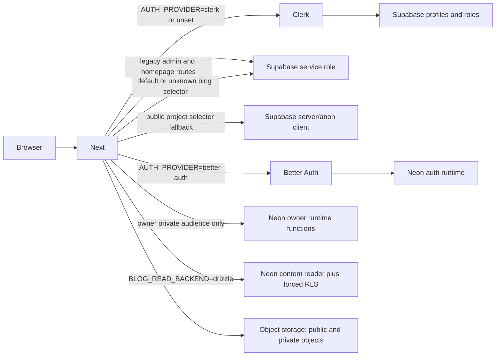

# Phase 3J.5F — Backend Boundary and Cutover Plan

**Status:** Offline architecture plan only. No application code, environment file, database, provider, or external service was changed or accessed. This plan does not authorize schema application or backend activation.

## Executive decision

Adopt a **bounded hybrid first**, then migrate selected CMS features to Neon only when each feature has complete read/write coverage and a rehearsed cutover. Keep the existing Clerk/Supabase website as the default operational mode. Develop Better Auth and private journal access behind an explicit, fail-closed integration mode with an allowlist of routes. Do not enable Better Auth for the whole site while its identity can reach legacy Supabase service-role routes or while the CMS still assumes Supabase profiles and authorization.

A full CMS migration is not required to resolve the current security findings. The immediate goal is a trustworthy auth/private-content boundary while preserving public URLs, public rendering, and the cinematic redesign. Supabase may remain the system of record for public homepage and legacy CMS features during that stage, but those paths must be explicitly classified, their authorization source must be compatible with the selected auth mode, and there must be no silent backend fallback.

## Repository and route inventory

The working tree remains on `feat/cinematic-redesign` with extensive pre-existing modified and untracked work. This plan makes no source edits. Inventory is from local route declarations and import/call-site searches; it does not imply every UI action was exercised.

### Backend ownership matrix

| Feature/path | Current implementation | Current data/auth owner | Intended near-term owner | Cutover notes |
|---|---|---|---|---|
| Public homepage composition (`src/app/page.tsx`, section components) | Homepage is rendered from existing components; project data is loaded through home project APIs/hooks; section content/media remains legacy-backed | Supabase for home projects/media and legacy section data; Clerk/Supabase profile model | Supabase, explicit legacy-public ownership | Preserve markup, ordering, DTOs, and URLs. Inventory any direct browser Supabase reads before mode activation. |
| Homepage project list/detail/media (`/api/home/projects`, `/api/home/projects/[id]`, `/api/home/projects/[id]/media`) | Direct Supabase server client | Supabase | Supabase initially; later feature-sliced Drizzle read repository if migration is justified | Must not be assumed covered by `PROJECT_READ_BACKEND`; list/media routes are still direct Supabase. |
| Public project page and project lookup (`/projects/[slug]`, `src/lib/projects/public.ts`) | `PROJECT_READ_BACKEND=drizzle` selects Drizzle; every other value uses Supabase server client | Supabase by default; optional Neon content-reader | Supabase in legacy mode; Neon only in explicit private-content integration mode or after slice tests | Replace binary selector with central validated configuration before enabling Better Auth. Preserve slug and not-found behavior. |
| Public blog list/detail APIs (`/api/public/blogs`, `/api/public/blogs/[slug]`) | `src/lib/blog/read.ts`; exact `drizzle` selects Neon repository, otherwise Supabase service-role | Supabase by default; optional Neon content-reader | Supabase in legacy mode; Neon content-reader/RLS in Better Auth private-content mode | Critical fail-closed boundary: no fallback to service-role for invalid/missing selector when Better Auth mode is selected. |
| Public/private blog pages (`/[slug]`, `/blog`, `/blog/[slug]`) | Server page and API use blog read helpers; editor/admin pages use legacy admin repository | Content: selectable Supabase/Neon; auth: Clerk default, Better Auth conditional | Same explicit mode as public blog APIs | URL compatibility and draft visibility rules must have parity tests. |
| Private journal media (`/api/private/journal-media/[mediaId]`) | Drizzle content-reader if exact selector says `drizzle`, otherwise Supabase service-role lookup; streams object and uses no-store | Supabase or Neon metadata; storage provider/object ACL independent | Neon/RLS metadata authorization plus private object delivery | Never allow fallback to Supabase in Better Auth mode. Existing permanent public object URLs cannot be made private by this route. |
| Private audience owner API/dashboard (`/api/admin/private-audience`, `/admin/private-access`) | Better Auth viewer plus owner-operation DB functions; synthetic tests offline | Neon owner-runtime functions; Better Auth auth pool | Neon only after schema/RLS/function verification and separate live approvals | This is the one narrowly scoped owner workflow. Keep owner functions as sole capability mutation path. |
| Better Auth API/session (`/api/auth/[...all]`), sign-in/sign-up conditional pages, provider middleware | Better Auth and `NEON_AUTH_DATABASE_URL` when selected; Clerk otherwise | Better Auth + Neon auth-runtime, or Clerk + Supabase | Keep Clerk/Supabase default; dedicated Better Auth test mode only | Reject missing/unknown providers and incompatible backend combinations at startup/request boundary. Never silently mix sessions. |
| Profile and user administration (`/api/profile`, `/api/admin/profile`, `/api/admin/users/**`, `/admin/users`) | `/api/profile` branches by `AUTH_PROVIDER`; legacy user/admin endpoints and profile helpers still use Supabase service-role | Clerk/Supabase legacy profile; Better Auth profile data for only some paths | Legacy mode remains Clerk/Supabase. Better Auth mode must deny unsupported legacy admin routes until ported | User ID namespaces and role semantics must not be assumed compatible across providers. |
| Blog CMS posts (`/api/admin/posts`, `/api/admin/posts/[slug]`, `/admin/posts/**`) | Supabase service-role CRUD; UI uses these APIs | Supabase + legacy admin guard | Supabase in legacy mode; future Neon writer functions/repository after transactional design | No Neon CMS writer exists. Cover create/edit/draft/publish/unpublish/delete and revision conflicts before moving ownership. |
| Blog CMS media metadata (`/api/admin/media/[mediaId]`, `/api/admin/posts/[slug]/media/**`) | Supabase service-role CRUD/link/order; upload routes also call storage/provider helpers | Supabase metadata; S3/object storage for bytes | Supabase in legacy mode; future separately scoped Neon media functions/repositories | Atomic post/media replacement and reorder still need defined transaction semantics. No object moves in this phase. |
| Project CMS and project media (`/api/admin/projects/**`, `/admin/projects/**`) | Supabase service-role CRUD and media metadata; S3 for object operations | Supabase | Supabase in legacy mode; migrate only as a complete project feature slice | A partial move risks homepage/project mismatch and orphaned media references. |
| Presigned upload (`/api/admin/uploads/presign`) | Admin guard and storage signing | Supabase-backed legacy authorization plus object storage | Legacy mode only until auth and storage boundary are ported | A Better Auth session must not pass through this route using Clerk/Supabase assumptions. |
| Terminal commands (`/api/terminal/commands`, `/api/admin/terminal/commands/**`, terminal pages) | Supabase service-role data access; Clerk/Supabase admin guard | Supabase | Supabase in legacy mode; unsupported in Better Auth mode until explicitly migrated | Not part of private journal requirement; exclude from initial auth allowlist or deny in Better Auth test mode. |
| First-owner bootstrap | Dedicated development runner and bootstrap DB role; not normal website request path | Neon auth/bootstrap role | One-shot, separately approved operation | Keep outside web runtime. Do not infer ownership from imported Supabase role/profile data. |
| Historical import and provenance | Phase 3I scripts and `legacy` staging tables | Neon development staging | Staging only until reviewed record-by-record | No automatic publication or auth import. Existing import validators pin pre-0003 migration hashes and need a planned update. |

### Route ownership summary

**Better Auth/Neon owned or intended:** `/api/auth/[...all]`, Better Auth sign-in/sign-up branch, auth-session/profile reads, the owner private-audience API, and content-reader repositories for blog/project reads when explicitly enabled.

**Still Supabase owned:** homepage project list/detail/media APIs; admin posts/media/project/user/terminal CRUD; legacy profile/admin guard; several public CMS reads by default; existing media metadata and legacy section content. `supabaseAdmin()` is a service-role boundary and must be treated as privileged even where the route performs application checks.

**Storage separate from either database:** uploaded object bytes, public portfolio media, legacy S3 URLs, and private-journal proxy delivery. Database RLS does not revoke a public object URL. Private media requires provider-side private storage and an authorized proxy or short-lived signed retrieval design.

### Current backend dependency diagram

This diagram shows the dangerous independent switches: the auth selector does not control all data selectors, and invalid reader values fall through to Supabase. A centralized mode parser must replace this topology before Better Auth activation.

## Approach comparison

| Dimension | Preserve Supabase public CMS + isolate Better Auth/private Neon | Gradually migrate CMS slices to Neon |
|---|---|---|
| Security | Can close private-content boundaries without moving all public CMS. Safe only with explicit route allowlist and no Better Auth-to-service-role fallback. Supabase service-role paths remain privileged legacy surfaces. | Reduces dual authorization over time, but each moved slice needs least-privilege writes, row-level policy/transaction coverage, and cutover controls. Incomplete slices can create mixed reads/writes. |
| Operational complexity | Lower near-term, but two data/auth systems and explicit boundary monitoring remain. | Higher during each migration; lower only after a feature is fully moved and legacy path is retired. |
| Migration effort | Small: central mode validation, private/blog reader consistency, targeted auth wiring and route denials. | Medium/high: schemas, migration runner, repositories, mutation procedures, DTO parity, media and admin workflows, reconciliation. |
| Data consistency | Supabase remains authority for legacy public content; Neon auth/private access is distinct. Avoid writing the same logical field in both stores. | Requires one-way source-of-truth handoff per feature; dual writes should be avoided. Snapshot/backfill/reconciliation and rollback windows needed. |
| Frontend compatibility | Highest. Existing endpoints and DTOs remain unchanged; backend routing is server-side. | Good if API contracts are held stable, but requires extensive behavioral parity across CRUD, status, ordering, and media flows. |
| Fit for current findings | Resolves the Better Auth/private boundary first without claiming complete CMS migration. | Necessary later only for features whose access model or operational goals justify it; not necessary to close current P1s. |

## Fail-closed backend configuration design

Do not add another independent boolean. Replace implicit selectors with a validated, discriminated server configuration (exact names are a future implementation choice):

1. **`legacy` mode:** Clerk + Supabase only. Preserve current defaults explicitly; require the legacy provider/config as a coherent set. No Neon credentials are selected by fallback.
2. **`better-auth-private-test` mode:** Better Auth + Neon auth/content/owner roles, with an explicit route allowlist. Blog and private-media reads must use Neon content-reader/RLS; owner audience operations must use owner functions. Any unsupported CMS/admin/homepage mutation endpoint returns a controlled unavailable response before obtaining a Supabase service client.
3. **Future `neon-cms-slice` mode:** only introduced per completed feature slice. The feature's reads and writes must share the declared Neon source of truth; no dual-write fallback.

Validation must reject: unset mode where Better Auth is requested; unknown enum values; `AUTH_PROVIDER` inconsistent with mode; a Drizzle blog/private-media reader paired with Clerk; Better Auth paired with Supabase fallback selectors; missing role-specific Neon URLs; mismatched project/branch/endpoint/database/host among role URLs; public registration when provider or persistence mode is unsupported; and any route declared Neon-owned without its repository/function implementation. Failure must be controlled and fail closed, never “try the other backend.” Legacy defaults remain unchanged until an explicit activation step.

All auth-provider checks, blog/project data-source dispatch, admin guards, and Supabase service-role construction should consult one validated server-only mode object. Route-level allow/deny must happen before a service-role client is constructed. This prevents capability/auth identity mismatch and avoids accidentally treating a Better Auth user ID as a Clerk/Supabase profile ID.

## Migration 0003 manifest update plan (offline, not executed)

The new `0003_early_blizzard.sql` adds a generated session-token digest and index; migration ordering already places it after 0002. The current Phase 3F apply/verify scripts and Phase 3J.5A bootstrap plus Phase 3I import verifiers pin the original three hashes. They cannot simply be reused for an incremental database that now also contains legacy staging data.

Prepare a versioned manifest update, then a separately reviewed development-only incremental runner that:

1. Pins the exact hashes for 0000–0003 and validates the journal/order offline.
2. Requires the live ledger to match exactly 0000–0002 before it starts, with no unknown entries.
3. Verifies expected application schema state and verifies that legacy staging/provenance row counts are unchanged; it must not require the entire database to be empty.
4. Acquires a migration lock, runs only 0003 transactionally if supported by its statements, and stops on any precondition/checksum drift.
5. Verifies resulting generated column definition, uniqueness/index validity, migration ledger and unchanged app/auth/staging counts; no automatic retry/repair.
6. Updates the read-only post-migration verifier and future bootstrap/import verifiers to recognize both explicit schema states (pre-0003 and post-0003), rather than rewriting historical Phase 3H evidence.

The manual RLS/function artifact is a distinct approval and verification gate after 0003, role provisioning, and exact effective ACL checks. No migration or SQL is run by this plan.

## RLS and effective privilege verification requirements

Policy names alone are insufficient. Before granting content-reader `SELECT`, read-only verification must compare each protected table's `pg_class.relrowsecurity` and `relforcerowsecurity`, and the complete `pg_policy` definition: command, `polpermissive`, role OIDs, `USING`, and `WITH CHECK` expressions. Normalize/compare expressions against reviewed expected semantics and stop on unknown policies, extra permissive policies, or owner/table mismatch.

For each helper and owner function, inspect `pg_proc` identity/signature, owner, `prosecdef`, `proconfig` fixed search path, volatility, language, and function body/hash where available; check dependency targets and `EXECUTE` ACLs including `PUBLIC`, inherited memberships, and overloads. For roles, inspect login/superuser/createdb/createrole/replication/bypassrls/inherit flags, memberships in both directions, database `CONNECT`, schema `USAGE/CREATE`, table and column ACLs, sequence ACLs, and effective privileges after inheritance. Verify content-reader owns no protected object. Compare direct and effective privileges, not only configured grants.

Behavioral tests against isolated PostgreSQL 18 remain required: anonymous/no-digest denied; malformed, expired, deleted, blocked, and revoked sessions denied; public rows readable under public predicate; private row/media readable only to current audience/owner; cross-post media denied; row changes observed on subsequent statements; owner list/mutation limited to exact functions; audit failure rolls back capability change; unauthorized role cannot read private tables even with arbitrary custom GUC. Also validate application-role inability to `SET ROLE`, bypass RLS, or reach unexpected databases. These tests are not satisfied by static SQL string checks.

## Ordered implementation roadmap and gates

### Gate 0 — Inventory and contract freeze (offline)

- Confirm route-to-feature ownership matrix and DTO/URL compatibility fixtures.
- Name the legacy default and Better Auth test mode; enumerate route allowlist and denylist.
- Verify no same feature is written to both backends.
- **Go:** all routes have one documented owner, auth principal, and data source. **No-go:** unknown/direct service-role route remains unclassified.

### Gate 1 — Central fail-closed mode configuration (offline)

- Implement a typed server-only mode parser and startup/request validation.
- Route all auth and repository selectors through it; disallow fallback and reject incompatible combinations.
- Add tests proving malformed values fail before Supabase/Neon clients instantiate and Better Auth mode cannot reach unsupported Supabase admin routes.
- **Go:** full route matrix tests pass; legacy mode behavior remains byte/DTO compatible. **No-go:** any unlisted route can instantiate broad credentials.

### Gate 2 — Migration manifest and semantic SQL verifier (offline review)

- Prepare 0003-aware incremental manifest/runner changes, checksums, and postflight states without execution.
- Upgrade RLS verifier to validate full policy and function semantics and effective grants.
- **Go:** offline checksums/schema artifacts align; runner has explicit pre-0003 and post-0003 states and preserves staging. **No-go:** runner assumes empty database or only checks object names.

### Gate 3 — Database-only isolated validation (separate approval required)

- On independently attested development only, review exact current ledger/staging state; apply 0003 under its own approval; verify read-only.
- Provision least-privilege roles and apply manual RLS functions only under separate approvals; run PostgreSQL 18 security semantics suite.
- **Go:** effective privileges/policies match and behavioral tests pass with synthetic users/content. **No-go:** any unexpected policy, ACL, membership, log exposure, bypass path, or partial state.

### Gate 4 — Better Auth isolated auth smoke test (separate approvals)

- Configure development-only provider credentials and role URLs; test registration, OAuth callback, verified email, session redaction, logout, expiration, blocked status, and current role reads with synthetic accounts.
- Do not import historical auth identities or elevate imported users.
- **Go:** actual HTTP behavior and sanitized logs demonstrated; owner bootstrap separately approved. **No-go:** digest/token reaches logs/client, wrong target, identity mismatch, or provider mode affects legacy routes.

### Gate 5 — Private content and media boundary test (separate approvals)

- Test read-only private blog access, grant/revoke, stale session behavior, and private media retrieval with synthetic records and private test object.
- Verify storage object itself is not publicly readable and response is private/no-store. Existing public legacy objects are not assumed private.
- **Go:** database and object-storage authorization both deny after revocation/unpublish. **No-go:** permanent public URL or Supabase service-role fallback retrieves private content.

### Gate 6 — Feature-sliced CMS decision

- Keep public CMS on Supabase unless a feature-specific benefit warrants migration. For any chosen slice, build complete Neon read and write contracts, transactional semantics, compatibility tests, dry-run/backfill and reconciliation, exact cutover/rollback, then independently approve cutover.
- Candidate order if needed: public project read parity; project CRUD/media as a complete slice; blog read/write plus revision/publish/media transactions; homepage sections/media; terminal/admin user management last.
- **Go:** one source of truth after cutover, no dual write, rollback rehearsed, legacy endpoint contracts retained. **No-go:** partial mutation flow, data divergence, or unsupported Better Auth admin route.

## Security blockers and prerequisites

1. **Current status remains NO-GO for Better Auth integration** until all P1s in Phase 3J.5E are closed: backend selector fallback, 0003-aware migration tooling, semantic RLS/function preflight, and complete route/feature ownership.
2. Existing CMS authorization uses legacy admin/profile helpers and Supabase service-role routes. Better Auth cannot be enabled globally until these are either migrated or explicitly unreachable in its mode.
3. Existing Supabase service-role reads bypass Supabase RLS. Keep them only in explicitly declared legacy routes with a compatible Clerk/Supabase auth contract.
4. Public S3/media URLs and cache copies cannot be revoked by database migration. Private object storage configuration and proxy checks are a separate prerequisite for private-media tests.
5. Digest is replayable bearer material. Actual Next response redaction and PostgreSQL/Neon/provider logging behavior, expiry/logout/revocation and concurrency need real development validation before private reader enablement.
6. PostgreSQL 18 RLS, function ownership, policy execution, generated digest index, role ACLs, and transactional rollback have only static/offline evidence.
7. Do not import Supabase password hashes, sessions, or privileged flags into Better Auth. Historical content staging remains distinct from public application tables and publication.

## Exact files anticipated for future changes

This is a planning inventory, not authorization to edit them. Additional files may be added only after route inventory review.

### Mode boundary and identity

- `src/lib/auth/viewer.ts`
- `src/lib/auth/get-better-auth-viewer.ts`
- `src/lib/auth/better-auth.ts`
- `src/lib/auth/session-token-digest.ts`
- `src/lib/db/client.ts`
- `src/lib/supabase/admin.server.ts`
- `src/lib/admin/requireAdmin.ts`
- `src/lib/admin/requireAdminApi.ts`
- `src/middleware.ts`
- `src/app/api/auth/[...all]/route.ts`
- `src/app/api/profile/route.ts`
- `src/app/sign-in/[[...sign-in]]/page.tsx`
- `src/app/sign-up/[[...sign-up]]/page.tsx`
- New central server-only backend-mode module and its tests.

### Public content and private-media routing

- `src/lib/blog/read.ts`
- `src/lib/projects/public.ts`
- `src/lib/db/content-session.ts`
- `src/lib/db/repositories/blog.ts`
- `src/lib/db/repositories/projects.ts`
- `src/app/api/public/blogs/route.ts`
- `src/app/api/public/blogs/[slug]/route.ts`
- `src/app/api/private/journal-media/[mediaId]/route.ts`
- `src/app/api/home/projects/route.ts`
- `src/app/api/home/projects/[id]/route.ts`
- `src/app/api/home/projects/[id]/media/route.ts`
- `src/app/page.tsx` only if inventory proves direct data access there; avoid visual/layout edits.

### CMS and legacy admin routes that must either be explicitly legacy-only or ported

- `src/app/api/admin/posts/route.ts`
- `src/app/api/admin/posts/[slug]/route.ts`
- `src/app/api/admin/posts/[slug]/media/route.ts`
- `src/app/api/admin/posts/[slug]/media/link/route.ts`
- `src/app/api/admin/posts/[slug]/media/reorder/route.ts`
- `src/app/api/admin/posts/[slug]/media/upload/route.ts`
- `src/app/api/admin/media/[mediaId]/route.ts`
- `src/app/api/admin/projects/route.ts`
- `src/app/api/admin/projects/[id]/route.ts`
- `src/app/api/admin/projects/[id]/media/route.ts`
- `src/app/api/admin/projects/[id]/media/[mediaId]/route.ts`
- `src/app/api/admin/uploads/presign/route.ts`
- `src/app/api/admin/profile/route.ts`
- `src/app/api/admin/users/route.ts`
- `src/app/api/admin/users/[id]/route.ts`
- `src/app/api/admin/users/me/route.ts`
- `src/app/api/admin/terminal/commands/route.ts`
- `src/app/api/admin/terminal/commands/[id]/route.ts`
- `src/app/api/terminal/commands/route.ts`
- `src/lib/admin/getAdminPost.ts`
- `src/lib/profile/getUserProfile.ts`
- `src/lib/profile/requireAdmin.ts`
- CMS hooks/data callers under `src/components/admin/**` and admin page loaders under `src/app/admin/**` if a feature's API contract changes.

### Migration and verification artifacts

- `drizzle/meta/_journal.json`, `drizzle/0003_early_blizzard.sql`, `drizzle/meta/0003_snapshot.json`
- `scripts/phase3f/apply-development-migrations.mjs`
- `scripts/phase3f/verify-development-migrations.mjs`
- `scripts/phase3j5a/bootstrap-first-owner-development.mjs`
- `scripts/phase3i/import-legacy-development.mjs`
- `scripts/phase3i/verify-legacy-import.mjs`
- `scripts/phase3j5c/grant-content-reader-review-only.sql`
- `scripts/phase3j5c/verify-isolated-roles-review-only.sql`
- `drizzle/manual/phase3j5d_privilege_isolation.sql`
- Associated `tests/phase3e/**`, security/integration tests, and the Phase 3J.5C/D/E docs.

## Final recommendation

**Plan for bounded hybrid ownership now; do not approve Better Auth activation yet.** Preserve Clerk/Supabase as the working website mode. Close the boundary and verifier P1s, then test Better Auth and private reads as a narrowly allowlisted development integration. Keep public homepage/CMS features on Supabase until a complete feature slice demonstrates a reason to migrate and can be cut over without dual writes. This minimizes disruption to the website and cinematic redesign while making the migration measurable and reversible.
