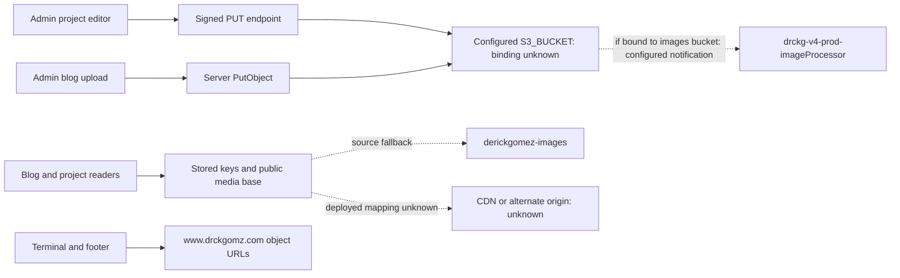

# drckgomz.com AWS audit

Date: 2026-11-11. Status: **read-only AWS configuration audit continued; media publication boundary is inadequate in the inspected bucket policy; some infrastructure evidence remains permission-limited**. Observation window ended approximately 14:12 UTC.

## Credential verification, method and scope

The owner explicitly confirmed that the exposed key was revoked and replaced and authorized `drckgomz-audit`. That attestation resolves the previous continuation's credential gate; this audit did not independently inspect credential rotation history. No credential values, hashes, files or environment values were displayed or saved.

`aws sts get-caller-identity --profile drckgomz-audit --no-cli-pager` succeeded and returned account `663855381209`, ARN `arn:aws:iam::663855381209:user/drckgomz-audit`. The initial sandbox call could not reach `https://sts.us-east-1.amazonaws.com/`; the approved network-enabled retry succeeded. All AWS reads used the audit profile. CLI was used because the prior MCP startup had timed out; MCP was not retried.

Only the two authorized buckets, their account-level S3 public-access-block setting, and the exact Lambda referenced by the images bucket were queried. No bucket/object inventory, object downloads, private media reads, database operations, AWS writes, IAM changes, deployments, commits or pushes occurred. No unrelated resources were queried. `drckgomzlog` was returned as a logging destination but was not accessed. Existing unrelated working-tree changes were preserved. Local source is not evidence of deployed production code.

Successful read operations demonstrate the permissions actually usable for these calls; they do not prove that this identity is globally read-only. IAM policies were not inspected and no write operation was tested.

## Verified AWS configuration

Evidence: AWS CLI `s3api` reads below, each explicitly scoped with `--bucket` and `--profile drckgomz-audit`. Both `get-bucket-location` responses returned `LocationConstraint: null` (us-east-1).

| Configuration / CLI operation | `derickgomez-images` | `www.drckgomz.com` |
| --- | --- | --- |
| `get-bucket-policy` | Public `s3:GetObject` grants described below | Public `s3:GetObject` on `arn:aws:s3:::www.drckgomz.com/*` |
| `get-bucket-policy-status` | `IsPublic: true` | `IsPublic: true` |
| `get-public-access-block` | All four flags false | All four flags false |
| `get-bucket-acl` | Only canonical bucket owner has `FULL_CONTROL`; no public bucket ACL grant | Same owner-only grant |
| `get-bucket-ownership-controls` | `AccessDenied` | `AccessDenied` |
| `get-bucket-lifecycle-configuration` | One enabled `Move-Old-Files` rule on `standard/`; details below | `NoSuchLifecycleConfiguration` |
| `get-bucket-notification-configuration` | One unfiltered Lambda notification; details below | Successful empty response: no configured notifications returned |
| `get-bucket-versioning` | `Status: Enabled` | Successful empty response: versioning not enabled/suspended |
| `get-bucket-logging` | Enabled to `drckgomzlog`, empty prefix, partitioned prefix with `PartitionDateSource: EventTime` | Successful empty response: server access logging not configured |
| `get-bucket-website` | `NoSuchWebsiteConfiguration` | Index and error document both `index.html` |
| `get-bucket-encryption` | Default `AES256`, `BucketKeyEnabled: true`, SSE-C blocked | Same |

Encryption at rest does not restrict authorized/public reads. Owner-only **bucket** ACLs do not establish object ACLs or Bucket owner enforced ownership. Neither policy grants public writes. Other identity/access paths and object-level controls were not exhaustively audited.

### Public policy and publication separation

The images bucket policy has these unconditional `Allow` statements with `Principal: "*"` and `Action: "s3:GetObject"`:

- `PublicReadForStandardDerivatives`: `arn:aws:s3:::derickgomez-images/standard/*`.
- `PublicReadOriginalsByScope`: resources `arn:aws:s3:::derickgomez-images/*`, plus `hero/*`, `about/*`, `blog-images/*`, and `projects/*` under that bucket.

The bucket-wide `/*` resource includes every key prefix; the narrower entries do not limit it. There are no publication-status, tag, identity or prefix conditions distinguishing unpublished originals from published copies. Both buckets are classified public by S3 policy status, and bucket-level Block Public Access does not restrict them.

**Finding: published and unpublished blog media are not adequately separated by this bucket policy.** Source uploads select the same configurable bucket/prefix irrespective of post status. If production binds `S3_BUCKET` to `derickgomez-images`, uploaded `blog-images/<post-id>/...` objects fall within its public-read grant, including drafts/private posts. Application post authorization does not revoke that grant. No database or deployed environment was read, so the presence of actual draft objects and the production bucket binding remain unverified.

Account-level `get-public-access-block` was denied. Effective higher-level restrictions and object-specific encryption/access behavior remain unknown; no anonymous request or object body was fetched. Consequently this audit confirms public policy grants and the missing publication boundary, rather than claiming every existing object was successfully downloaded anonymously.

### Lifecycle and source availability risk

`Move-Old-Files` applies only to `standard/`: transition at 30 days to `STANDARD_IA`, at 180 days to `DEEP_ARCHIVE`; remove expired delete markers; abort incomplete multipart uploads after 19 days. The response reports `TransitionDefaultMinimumObjectSize: all_storage_classes_128K`. No noncurrent-version expiration or transition is present in this returned rule; no lifecycle covers other prefixes.

`src/components/home/sections/about/AboutSection.tsx` constructs `standard/about/<tail>.w800.webp` and `.w1600.webp` URLs. **If the configured media base points to this bucket, eligible aged derivatives are subject to archival despite being intended for website delivery.** Deep Archive retrieval requires restoration and is unsuitable for immediate website asset reads. Actual object ages/storage classes and a current outage were not checked. Versioning plus no noncurrent-version retention rule can also retain old media and costs indefinitely. See [AWS lifecycle transition guidance](https://docs.aws.amazon.com/AmazonS3/latest/userguide/lifecycle-transition-general-considerations.html).

### Legacy Lambda and CloudFront dependencies

Images bucket `get-bucket-notification-configuration` returned:

- Notification ID `drckg-v4-prod-imageProcessor-68a737133cefb25bff959852b8f04754`.
- Function ARN `arn:aws:lambda:us-east-1:663855381209:function:drckg-v4-prod-imageProcessor`.
- Events `s3:ObjectCreated:*`; no key prefix/suffix filter returned.

This is a **live configured dependency** despite the v4 name and absence of direct invocation in website source. It does not establish successful invocation, current traffic or processor behavior. A new v5 upload to this bucket is within the trigger's configured event scope. Do not retire the processor based on source search alone.

Exact-function `lambda get-function-configuration` (with output projection excluding environment variables) and `lambda get-policy` were both denied. No function package, environment, logs, metrics or role policies were fetched. Same-bucket derivative writes could trigger recursion without code guards because no notification filter is present; this is a conditional risk, not observed recursion. The handler/output destination and invocation permission remain unresolved. See [AWS S3/Lambda notification guidance](https://docs.aws.amazon.com/lambda/latest/dg/with-s3.html).

No CloudFront distribution ID/domain or OAC principal was found in the scoped policies, notifications or searched local `src`, `scripts`, `docs`, `next.config.ts`, and `package.json`. S3 configuration is not a reverse index of CloudFront origins. No account-wide distribution/DNS/Lambda enumeration was performed, since it could inspect unrelated infrastructure. **CloudFront presence, DNS routing, edge functions and production traffic remain unverified, not absent.** A website-specific distribution identifier or an owner-supplied scoped configuration export is needed for a bounded read under existing permissions.

## Permission denials and coverage limits

These exact actions were denied with the reason `because no identity-based policy allows the <action> action` (Lambda used `AccessDeniedException`; S3 used `AccessDenied`):

| Action | Resource/scope |
| --- | --- |
| `s3:GetBucketOwnershipControls` | Each of the two scoped bucket ARNs |
| `s3:GetAccountPublicAccessBlock` | Account `663855381209`, us-east-1 request |
| `lambda:GetFunctionConfiguration` | Exact processor ARN above |
| `lambda:GetPolicy` | Exact processor ARN above |

Each denied operation was stopped without alternate identities, IAM changes or bypass attempts. Earlier `s3:GetBucketPolicyStatus` and `s3:GetBucketAcl` denials are historical: both now succeed for both buckets. This does not establish when or why permission coverage changed. Missing website/lifecycle configurations above are explicit absence responses, distinct from denials. No permission expansion is requested by this audit.

## Verified local source findings

Source paths below are relative to repository root. Configuration variable **names** describe code dependencies; their deployed values were not inspected.

| Source | Actual reference or behavior | Limit |
| --- | --- | --- |
| `src/app/api/admin/posts/[slug]/media/upload/route.ts` | Admin-gated direct `PutObject` to configurable `S3_BUCKET`; `S3_MEDIA_PREFIX` defaults to `blog-images`; key `blog-images/<post-id>/<timestamp>-<filename>`; stores key in media record | No concrete deployed bucket binding verified. Upload sets `Cache-Control: public, max-age=31536000, immutable` regardless of publication status. Does not invoke Lambda directly. |
| `src/app/api/admin/uploads/presign/route.ts` | Admin-gated five-minute signed PUT; key `projects/<project-id>/<UUID>-<sanitized-filename>` in configurable bucket | Signed upload does not protect subsequent reads. Code explicitly supplies environment-sourced static AWS credentials; values were not read. Project ID is required but no parent lookup is performed here. |
| `src/app/admin/projects/[id]/components/ProjectMediaManager.tsx` | Uses presign endpoint, uploads directly, constructs/stores media-base URL; UI names `s3://derickgomez-images/projects/` | UI label is not proof of actual upload target. Imported by project editor client. |
| `src/components/blog/AllPostsGrid.tsx` | Media-base fallback `https://derickgomez-images.s3.amazonaws.com` | Referenced by blog page; deployed override unknown. |
| `src/lib/blog/media.ts` | Preserves absolute URLs and local `/uploads/`; expands other keys against public media base | No signed GET generation in this normalizer. |
| `src/lib/blog/read.ts` | Applies viewer/parent visibility checks before serializing post/media references | Application authorization does not establish object-origin authorization. No database calls were executed in this audit. |
| `src/components/terminal/components/VideoBackground.tsx` | Fallback base `https://s3.us-east-1.amazonaws.com/www.drckgomz.com`; keys `dockBackground.webm`, `patio2Background.webm`, corresponding `.mp4` fallbacks, `terminalBackground.jpeg` | Imported by terminal page. Actual bucket/object existence and overrides unknown. |
| `src/components/terminal/hooks/useMedia.ts` | Same bucket fallback, key `broken.mp4`; UI-gated media playback | Imported by TerminalShell; UI gates do not secure known origin URLs. |
| `src/components/blog/BlogFooter.tsx` | Hardcoded same bucket URLs for `youtube.png`, `x.png`, `instagram.png` | Footer is imported by blog/admin layouts and settings. Strong source evidence of intended public design assets. |
| `src/lib/projects/public.ts`, `src/app/api/home/projects/route.ts`, `src/components/home/sections/about/AboutSection.tsx` | Recognize/rewrite legacy `https://s3.us-east-1.amazonaws.com/www.drckgomz.com` and `https://www.drckgomz.com.s3.amazonaws.com` bases | Runtime record contents and configured replacement base unknown. |

Reviewed `src`, `scripts`, `package.json` and `next.config.ts` for Lambda, invocation SDK and image-processing references. No explicit Lambda invocation or processor identifier was found. Upload code writes straight to S3; an S3 notification, external service or CDN could still invoke processing. Notifications were inspected and prove configured Lambda wiring; deployed Lambda configuration was denied, and external backend code, runtime records and usage telemetry were not inspected. **The legacy image-processing Lambda cannot be declared unused or safe to delete.**

## Dependency map and classification

Here, **active** means referenced by current local application code, not proven production traffic. **Legacy** means compatibility/reference form, not permission to retire a resource.

| Resource/dependency | Classification | Reason |
| --- | --- | --- |
| `derickgomez-images` | Public policy; configured processor dependency; production source binding unknown | Blog fallback/project media label; current AWS reads verified |
| `www.drckgomz.com` | Active source reference | Direct footer links and terminal fallbacks; legacy hostname rewrite compatibility remains |
| Blog/project upload handlers | Active source paths | Direct S3 upload and signed PUT flows |
| Legacy S3 hostname forms | Legacy compatibility | Rewrite logic still accepts them; consumers can still depend on them |
| Legacy image-processing Lambda | Live configured S3 notification dependency | Exact ARN returned by images bucket; configuration/policy reads denied; execution unknown |
| CDN and DNS | Unknown | No scoped distribution identifier or DNS inspection |
| S3 website hosting | Configured on `www.drckgomz.com` | Both index/error documents `index.html`; images bucket has none |
| Duplicate originals/processed variants | Unknown | No object inventory performed; redundancy cannot be asserted |

Neither scoped bucket is established as redundant. Retain both pending dependency and traffic evidence. No deletion recommendation is justified.

## Public intent and exposure risks

**Source-based intent:** terminal backgrounds, social icons and published portfolio/blog assets appear designed for public display. This does not confirm owner intent for the entire bucket. Draft/private/archived editorial originals, thumbnails and variants should be confidential unless explicitly published.

**Verified current configuration:** both bucket policies allow public reads and both have all bucket-level blocking flags false. Bucket ACLs are owner-only, ownership controls and account-level blocking are denied. The images bucket's bucket-wide read grant includes unpublished-media prefixes. No public-write grant was found in the inspected bucket policies/ACLs; object ACLs and all other access paths were not reviewed.

**Source-based risks:** uploads do not choose a protected destination according to parent status; one configurable bucket/base serves multiple paths; absolute media links persist independently of parent visibility; blog uploads request public year-long caching. Cache-Control does not grant S3 permission, but can extend retention after authorized delivery. Changing a post to private will not revoke a known public URL or cached copy. Prefix naming and hidden UI commands are not authorization controls. Any image processor must preserve confidentiality for every derivative, not write private originals into a public output prefix.

## Proposed least-privilege private-media architecture — not implemented

1. Separate private editorial media from intentionally published assets, preferably with a dedicated private bucket to reduce shared-policy mistakes. Enable all four Block Public Access controls and Bucket owner enforced ownership for the private origin. Use encryption at rest and HTTPS; restrict bucket access to named application roles. These are recommendations, not current-state claims. See [AWS S3 security best practices](https://docs.aws.amazon.com/AmazonS3/latest/userguide/security-best-practices.html).
2. Use short-lived workload-role credentials. Scope upload role `s3:PutObject` to server-generated editorial/project prefixes. Scope delivery role `s3:GetObject` to private media prefixes. Do not grant public ACL writes, bucket policy changes, IAM operations or broad bucket listing. Add version reads, multipart or KMS permissions only if the selected flow requires them, scoped to the relevant resources.
3. Store server-owned bucket/key and parent/variant identity rather than an unrestricted public URL. An authenticated media endpoint must check fresh user capability, parent visibility/deletion and media association before issuing a short-lived signed GET. Signed PUT and GET authorization are separate. Never sign a caller-supplied arbitrary bucket/key. Return private/no-store responses for authorization endpoints and sensitive media; redact signatures from logs.
4. For CDN delivery, use an S3 REST origin with CloudFront OAC restricted to the exact distribution via `AWS:SourceArn`, plus signed viewer access. OAC alone does not restrict viewers. S3 website endpoints cannot use OAC. See [AWS origin access guidance](https://docs.aws.amazon.com/AmazonCloudFront/latest/DeveloperGuide/private-content-restricting-access-to-s3.html). If immediate revocation is required, use authorization on each media request; a signed URL remains a transferable capability until expiry.
5. Publish only explicitly approved copies/variants to the public path. Keep private originals and processing outputs private; give a processor read/write access only to its designated input/output prefixes and narrowly authorize its event source. Track derivative lineage and shared references before any migration. Prior public copies and downloads cannot be made confidential retroactively.
6. Plan version retention/lifecycle for drafts and derivatives after retention needs are agreed. Recommend scoped CloudTrail S3 data events, S3 access logging to a protected destination, and CloudWatch metrics/alarms with encrypted log storage and signature redaction. Costs include extra published/derived copies, retained versions, storage/request charges, CDN transfer/requests, optional KMS requests and telemetry ingestion/retention. Compare delivery costs using actual traffic before rollout.

See also `docs/PRIVATE_MEDIA_DELIVERY.md` for the existing proposed authorization contract. No architecture or policy changes were made.

## Prioritized action plan and unresolved evidence

All actions below are recommendations for separately authorized work; none were executed.

1. **P0 — Protect unpublished media.** Confirm production `S3_BUCKET`/media-base bindings without exposing secrets and identify draft/private associations through an owner-controlled process. Stage a private editorial origin and parent-authorized delivery flow before removing broad public grants. Publish explicit copies only; cover thumbnails, inline images and processor derivatives. Assess already distributed URLs and caches; changing policy cannot retract prior downloads. Avoid blanket blocking of both buckets before replacing active public assets.
2. **P1 — Resolve derivative archival risk.** Verify the About media-base binding and bounded known derivative metadata through an authorized operator. Keep assets required for live delivery in an immediately retrievable storage class; scope archival to genuinely cold media. Plan restoration only if an authorized inspection confirms archived active assets. No restore request was made.
3. **P1 — Preserve and document the processor dependency.** Obtain an owner-supplied sanitized processor configuration/invocation-policy/code summary and bounded usage evidence under existing authorized access. Confirm input/output prefixes, publication propagation, recursion guards and version invoked. Stage filtered events or separate output storage in later approved work; do not delete the function or disable notifications now.
4. **P2 — Close scope-limited unknowns.** Obtain ownership/account-public-block evidence and website-specific CloudFront/DNS identifiers or sanitized exports through an already authorized operator. Verify origin access, viewer authorization, edge associations and traffic before considering legacy retirement. Do not broaden this audit identity or enumerate client resources.
5. **P2 — Retention, recovery and observability.** Agree noncurrent-version retention for images; assess versioning, lifecycle and logging for the website bucket against its recovery requirements. Verify existing image access-log delivery through the owner; do not access the returned logging bucket in this audit. Replace environment-sourced static credentials in the project presigner with workload-role credentials during separately scoped application work.

Unresolved: actual unpublished-object presence, production code/configuration bindings, account/organization public-access restrictions, object ACLs/ownership mode, processor implementation/activity/permissions, archived live derivatives, CloudFront/DNS relationships and effective recovery/log retention. These limits prevent an end-to-end confidentiality or retirement sign-off.

Validation: refreshed bucket configuration reads, exact-function denied reads, targeted source inspection and documentation diff checks. No application tests were needed for this documentation-only update. Historical credential-gate statements in other infrastructure documents were not refreshed by this change; this report records the current continuation.
